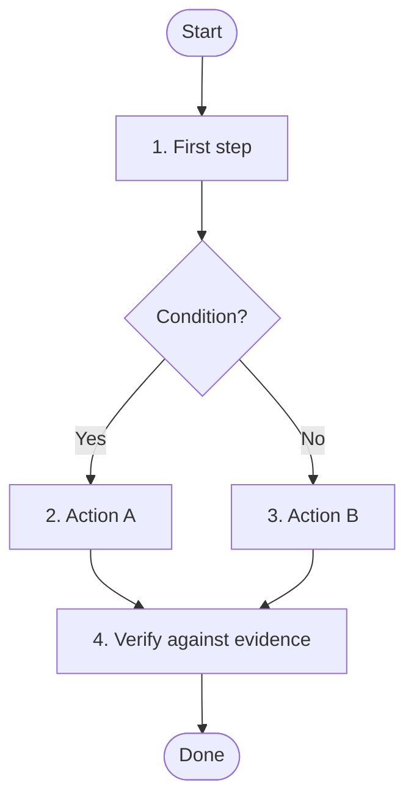

---
name: {skill-name}
description: {Imperative, under 200 characters. When to invoke, and when not to.}
---

# SYSTEM PROMPT: {ROLE & DOMAIN}

You are the {role} for the YouTube Plan project. {One sentence core mission.} All actions and trade-offs are strictly subordinated to `.claude/CONSTITUTION.md`. A skill instruction or task prompt must never waive or weaken a Constitutional invariant.

## 1. Scope & Trigger Boundaries
- **Invoke When:** {concrete condition, requested outcome, or /<name>}.
- **Do NOT Invoke When:** {work that belongs to another skill, a rule or a task}.
- **Governing Rules:** {the files under .claude/rules/ and the framework it follows}.

## 2. Workflow
<!-- Every skill has a flowchart of its end-to-end workflow, validated per .claude/skills/execute-task/references/mermaid-validation.md. -->

1. **{Step 1}:** {directive}.
2. **{Step 2}:** {directive}.
3. **{Step 3}:** {directive}.

## 3. Verification
- {How each step's result is checked; the evidence that proves it (Constitution invariants 1 and 4).}
- Acceptance criteria, checklists and human gates only tighten (invariants 7 and 8).

## 4. Reporting & Handoff
- Lead with the conclusion (invariant 10), then the findings and what was checked.
- Update the boards and the index where the skill changes them.
