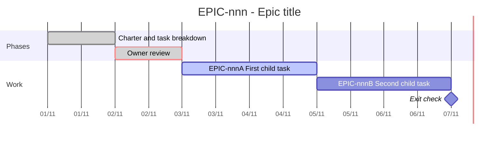

# EPIC-{nnn} — Tracking

<!-- High-level only: the Gantt, the task matrix, a one-line log and blockers. Context, approach, acceptance criteria and notes belong in each child task file. -->
- **Epic:** {link to the epic README}
- **Status:** {🔵 Planned / 🟡 In progress / ✅ Done (YYYY-MM-DD)}
- **Target completion:** {YYYY-MM-DD, or None — no deadline (cite Clarify §5.1)}
- **Renders:** GitHub Markdown, VS Code Mermaid preview, or mermaid.live.

---

## 1. Schedule (Gantt)

<!-- Required. One bar per child task and one per phase gate; every child of the epic README has a bar. Replace the sample bars. Whenever a child starts, finishes or is cancelled, the same pull request refreshes its bar (`active` → `done`, real dates; a cancelled bar keeps its dates and gains "(cancelled)") and moves the dependent bars. Validate per .claude/skills/execute-task/references/mermaid-validation.md before committing. -->

---

## 2. Task matrix

| Id | Task | Branch / PR | Risk | Status | Target / Merged |
| :--- | :--- | :--- | :-: | :--- | :--- |
| {EPIC-nnnA} | {summary, linked to its task file} | `{branch}` / {PR link} | {🟢 / 🟡 / 🔴} | {🔵 Planned / 🟡 Active / ✅ Merged} | {YYYY-MM-DD} |

---

## 3. Log

<!-- One line per event or pull request. -->
| Date | Item | Event and outcome |
| :--- | :--- | :--- |
| {YYYY-MM-DD} | Scaffold | Epic created, child tasks sliced. |

---

## 4. Blockers and dependencies

| Blocker or dependency | Tasks affected | Resolution / owner | Status |
| :--- | :--- | :--- | :--- |
| {e.g. the owner's answer to Q-nnn} | {task ids} | {who acts} | {🟡 Open / ✅ Resolved} |
