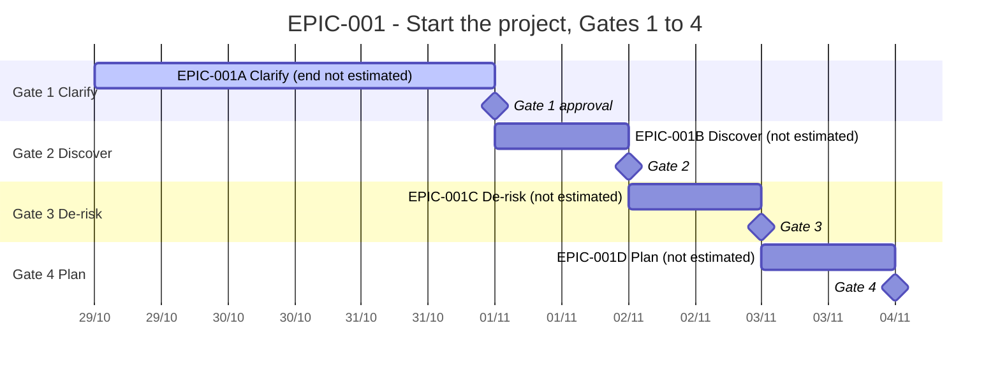

# EPIC-001 — Tracking

- **Epic:** [README](README.md)
- **Status:** 🟡 In progress
- **Target completion:** None — no deadline yet (Clarify C4, Q-008)
- **Renders:** GitHub Markdown, VS Code Mermaid preview, or mermaid.live.

---

## 1. Schedule (Gantt)

Durations of B, C and D are not estimated yet. Their bars show order only and are set when each task is sliced.

---

## 2. Task matrix

| Id | Task | Branch / PR | Risk | Status | Target / Merged |
| :--- | :--- | :--- | :-: | :--- | :--- |
| [EPIC-001A](incomplete/EPIC-001A_clarify.md) | Clarify — project charter approved | `claude/great-albattani-6cukhy` | 🟡 | 🟡 Active | — |
| EPIC-001B | Discover | — | 🔴 | 🔵 Planned | — |
| EPIC-001C | De-risk | — | 🔴 | 🔵 Planned | — |
| EPIC-001D | Plan | — | 🟡 | 🔵 Planned | — |

---

## 3. Log

| Date | Item | Event and outcome |
| :--- | :--- | :--- |
| 2026-10-29 | Scaffold | Epic created; EPIC-001A started with Clarify v0.1. |
| 2026-10-29 | EPIC-001A | Two rounds of questions answered; Clarify v0.2 written; waiting for both owners' approval. |
| 2026-10-30 | EPIC-001A | Clarify v0.3: P3 and G7 (how a channel grows); assumption log and source register added to the index. |

---

## 4. Blockers and dependencies

| Blocker or dependency | Tasks affected | Resolution / owner | Status |
| :--- | :--- | :--- | :--- |
| Answers to Q-001 to Q-009 | EPIC-001A | The owner | ✅ Resolved: answered or carried forward, 2026-10-29 |
| Both owners approve Clarify §7; how the partner records it (Q-010) | EPIC-001A | The owner and the partner | 🟡 Open |
