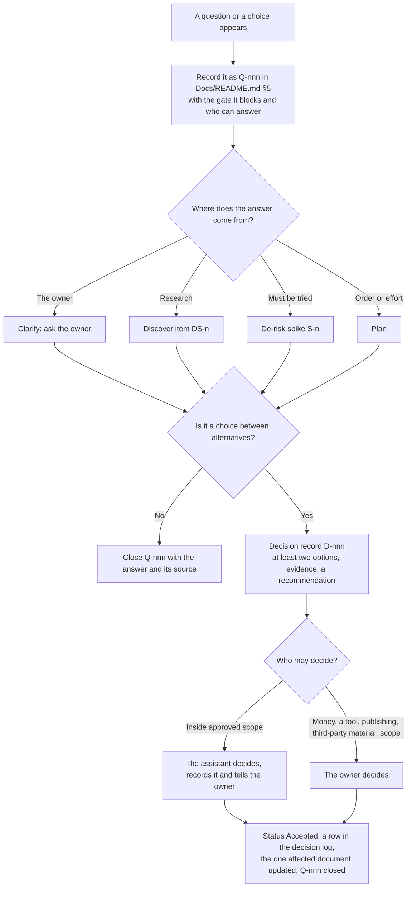
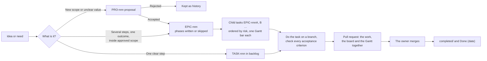

# PRO-001 — One project-management process for this repository

**Date:** 2026-10-29
**Status:** Proposed
**Source:** the owner, 2026-10-29: *"before start, you need to design process, what project management look like dir? what file? … and process of decision making? … epic, task plan"*. In short: design the folders, the files, how decisions are made, and how epics and tasks are planned, before any project work starts.
**Decision:** Pending — the owner decides (section 5).

## 1. Problem and evidence

The repository now holds two management systems that were copied from other projects and do not yet fit together (checked on `main` at `29a6d6f`, 2026-10-29):

| # | Finding | Evidence |
| :-- | :--- | :--- |
| 1 | **Two systems.** A project-level system (six gates, one index, documents under `Docs/`) and an epic/task system (`Tasks/epics/`, its own charter, Discover and De-risk inside each epic). Nothing says which one holds what. | `.claude/skills/Project-Manager/`, `.claude/skills/create-epic/SKILL.md` §3 |
| 2 | **IDs collide.** `D` means a decision in the document rules but a deliverable in the charter template; `R` means a risk in the rules but an experiment in the De-risk template and a finding in the Discover template; `O` is both an objective and an open question. | `.claude/rules/document-rules.md` §2, `.claude/templates/charter.md` §3, `derisk.md`, `discover.md`, `decision.md` §4 |
| 3 | **Missing files.** The epic and task skills cite `ONBOARDING.md`, 15 rule files (`task-execution-rule.md`, `report-task-rule.md`, `commit-rule.md`, `ci-rule.md` …) and scripts (`render_board.py`, `validate_skill.py` …) that do not exist here. | `grep` of `.claude/skills/` and `.claude/templates/` |
| 4 | **Wrong domain.** The skills and templates still describe a trading-bot code base: Binance orders, two repositories, test-driven development, test tiers, `file:line` citations, `Docs/SPEC/`, `Docs/MODULES/`. This project produces research, decisions and videos, not code. | `coordinate/SKILL.md` §3, `execute-task/SKILL.md` §4–5, `task.md` §3a–5 |
| 5 | **No project documents yet.** `Docs/README.md`, Clarify, Approach and Vocabulary are referenced but not written. | `.claude/skills/Project-Manager/SKILL.md`, "Where the facts are" |

If work starts now, each document would follow whichever system the writer happened to open, and the same fact would end up in two places.

## 2. Intended outcome and scope

**Outcome:** one process the owner can read in five minutes, which answers:
- Where does each kind of information live?
- Which file is used for each kind of work?
- Who decides what, and how a decision is recorded.
- How an idea becomes an epic, the epic becomes tasks, and a task gets done.

**In scope:** the folder layout, file types and IDs, the decision process, the epic and task lifecycle, the git workflow, and the list of changes to the AI rules and templates that this process needs.

**Out of scope:** any project content (the Clarify document, research, the niche, tools, budget). Those start only after this proposal is accepted.

## 3. Options and trade-offs

| Option | Benefit | Cost and risk | Evidence or precedent |
| :--- | :--- | :--- | :--- |
| A. Keep both systems side by side | Nothing to change now | The ID collisions and the duplicate homes for charters and decisions stay; every document starts with "which system?" | Finding 1–2 above |
| **B. Two levels: project in `Docs/`, work in `Tasks/`** | Each fact has one home. The six gates run once for the whole channel, and epics deliver the work. It fits the Project-Manager skill and the epic skill as they are written. | Two folders to learn; the epic skill and the templates need adapting (section 4.7) | PMBOK 6: project documents (charter, risk register) are separate from the work breakdown (WBS, work packages) |
| C. Everything as epics (the project charter becomes the EPIC-001 charter) | Only one folder (`Tasks/`) | Project-wide facts (niche, budget, acceptance) end up inside one epic; later epics have to link into it; the Project-Manager skill would need rewriting | — |

## 4. Recommendation — Option B

### 4.1 Two levels

| Level | Answers | Lives in | Changes how often |
| :--- | :--- | :--- | :--- |
| **Project** | Why the channel exists, scope, constraints, acceptance, gates, risks, project-wide decisions | `Docs/` | Rarely; each change is recorded |
| **Work** | What is being done now, by when, and what is done | `Tasks/` | Every task |

An epic never restates a project document; it links to it as its **north star** (the field already in `epic.md`).

### 4.2 Folder layout

```text
Youtube-Plan/
├── README.md                          # what the repository is and where to start (new)
├── Docs/                              # PROJECT level, for people
│   ├── README.md                      # the index: status, document map, approvals, decision log, open questions
│   ├── VOCABULARY/README.md           # project terms, one spelling each
│   ├── Project-Process/               # the method (exists, unchanged)
│   ├── Project-Management/
│   │   ├── Stakeholders.md            # who is involved, who approves
│   │   ├── Initiation-phase/
│   │   │   ├── Clarify/Clarify.md     # Gate 1: the project charter
│   │   │   └── Approach.md            # gates, exit criteria, risk register (R-n)
│   │   ├── Discover/Discover.md       # Gate 2: research, one section per item (DS-n)
│   │   ├── De-risk/
│   │   │   ├── De-risk.md             # Gate 3: index of spikes and verdicts
│   │   │   └── S{n}_{slug}.md         # one file per spike (e.g. the pilot video)
│   │   └── Plan/Plan.md               # Gate 4: milestones and the epic roadmap
│   └── Decisions/                     # project-wide decision records
│       └── D-{nnn}_{slug}.md
├── Tasks/                             # WORK level
│   ├── README.md                      # the board: epics, backlog, proposals, one line each
│   ├── proposal/PRO-{nnn}.md          # suggested new scope, waiting for a yes or no
│   ├── backlog/TASK-{nnn}_{slug}.md   # a standalone task
│   └── epics/EPIC-{nnn}_{slug}/       # as in the create-epic skill
│       ├── README.md  TRACKING.md     # hub and Gantt (always)
│       ├── charter/ discover/ derisk/ # only when the epic needs its own (proportionality)
│       ├── decisions/D-{nnn}_{slug}.md
│       └── incomplete/ completed/ cancelled/
└── .claude/                           # rules, skills and templates for the AI (not for people)
```

Production files (the scripts, voice files and videos of each episode) are not in this repository, as agreed. Whether per-episode notes belong here is `TODO → Plan phase`.

### 4.3 File types and IDs

All IDs are permanent and are never reused. The changes from today are in **bold**.

| ID | Item | Home | Template |
| :--- | :--- | :--- | :--- |
| P, O, DL, G, C, A, AC | Pain, objective, deliverable, grey area, constraint, assumption, acceptance criterion | Clarify (project) or an epic's `charter/` | `charter.md` **(aligned to these IDs)** |
| R-n | Risk | Approach §7 (project) | — |
| DS-n | Discover item | Discover (project) or an epic's `discover/` | `discover.md` **(findings become DS-n, not R)** |
| **S-n** | Spike (experiment) | De-risk (project) or an epic's `derisk/` | `derisk.md` **(experiments become S-n, not R)** |
| Q-nnn | Open question | `Docs/README.md` §5, the only register | — |
| **D-nnn** | Decision record | `Docs/Decisions/` or an epic's `decisions/`; **one global number** | `decision.md` |
| PRO-nnn | Proposal | `Tasks/proposal/` | `proposal.md` |
| EPIC-nnn | Epic | `Tasks/epics/` | `epic.md`, `tracking.md` |
| EPIC-nnnA | Epic child task | the epic's `incomplete/` | `task.md` **(made non-code)** |
| **TASK-nnn** | Standalone task | `Tasks/backlog/` | `task.md` (replaces `BOT-nnn`) |

The decision log in `Docs/README.md` §4 lists **every** decision record, project-wide or inside an epic, so there is one place to look.

### 4.4 How decisions are made



Rules:
1. **Who decides.** The owner decides anything that spends money, picks a tool or provider, publishes, uses someone else's material, or changes scope, acceptance, budget or deadline. The assistant decides wording, structure and choices inside an approved scope, and records each one.
2. **Evidence first.** A decision record shows at least two options, the evidence for each (with the date it was checked) and a recommendation, before anyone decides.
3. **Never edit a decided record.** A changed mind is a new record that supersedes the old one; both stay.
4. **A proposal is not a decision.** A PRO asks whether to take on new scope. A decision record chooses between alternatives inside work that is already accepted.
5. **One home per change.** A decision changes one document (Clarify for scope, Approach for gates or risks, Plan for order). The other documents link to it and never copy it.

### 4.5 How work flows: idea → epic → task



- **Epic:** a group of tasks with one measurable outcome, e.g. "a pilot video from story to upload". It writes its own charter, Discover or De-risk only when it needs one, and records "skipped, because …" otherwise (create-epic §4).
- **Task:** small enough for one pull request, with observable acceptance criteria. Status: Backlog → In progress → Done or Cancelled. A cancelled task is moved, never deleted.
- **Board and Gantt:** updated by hand in the same pull request as the work. No board script for now; one is added only if the board drifts in practice.

### 4.6 How the six gates map to epics

| Gate | Project document | Tracked as (e.g.) |
| :--- | :--- | :--- |
| 1 Clarify | Clarify, Stakeholders, Vocabulary | EPIC-001 "Start the project (Gates 1–4)", child A |
| 2 Discover | Discover (niche, language, monetization rules, tools, competitors) | EPIC-001, one child per research question |
| 3 De-risk | De-risk, e.g. spike S-1 "make one pilot video and measure hours and cost" | EPIC-001, one child per spike |
| 4 Plan | Plan: milestones and the epic roadmap | EPIC-001, last child; it creates EPIC-002 onwards |
| 5 Implement | — (the epics deliver it) | e.g. channel setup, production workflow, first batch of videos: `TODO → Plan phase` |
| 6 Validate | Results against Clarify §6 acceptance | the last epic, or a review task |

EPIC-001 skips its own charter, Discover and De-risk folders because the project-level documents are those phases. It still has a README and a Gantt, so the start-up work shows on the board like any other epic.

### 4.7 Git workflow and reporting

- One branch and one pull request per task, or per small batch of tasks in the same epic. Nothing is pushed to `main` directly.
- A documentation-only pull request needs no reviewer session; the owner reads it and merges it.
- Status is reported in the framework's format (where we are, blocking, done, risks, next), with the epic's Kanban and Gantt when a task starts.

### 4.8 What changes in the AI layer after acceptance

| Area | Change |
| :--- | :--- |
| `create-epic`, `execute-task`, `create-skill`, `coordinate` | Remove the trading-bot and code-only content (Binance, two repositories, TDD, test tiers, scripts); point `ONBOARDING.md` and the missing rules to the Constitution and the Project-Manager framework instead of creating 15 new files |
| `charter.md`, `discover.md`, `derisk.md`, `decision.md` | Align the IDs (section 4.3); the decision template's invariant check uses this project's 12 invariants |
| `task.md` | Replace "TDD / Reuse / Changes per file / test tiers" with "Approach / Output / Verification against the acceptance criteria" |
| `bug-report.md`, `case-study.md` | Park them until a real incident (e.g. a copyright claim) needs one; then adapt them into an incident template |
| `Project-Manager` skill, document rules, glossary | Add PRO, EPIC, TASK and S IDs, the two levels, and the single decision log |

These changes are done as one standalone task after acceptance, in their own pull request.

## 5. Decision needed

The owner settles these. Accepting them commits the project to this layout, and nothing else.

| # | Question | Recommendation |
| :-- | :--- | :--- |
| 1 | Option A, B or C (section 3)? | **B** |
| 2 | Track Gates 1–4 as EPIC-001 (section 4.6), or keep them as documents only, without an epic? | **EPIC-001**, so the start-up work has a board and a Gantt |
| 3 | `coordinate` (running several Claude sessions at once): adapt it now, or park it until it is needed? | **Park**: one session is enough until production starts |
| 4 | Boards and Gantts kept by hand, with no script? | **Yes**, until drift is seen |
| 5 | `bug-report.md` and `case-study.md`: park them until an incident needs one? | **Yes** |

## 6. Outcome and follow-up

Pending.
